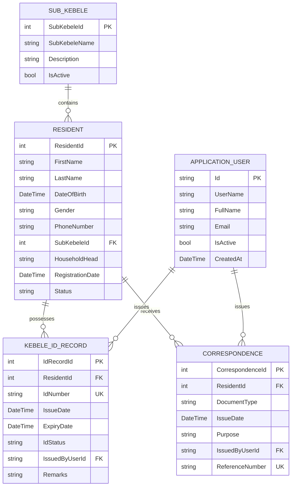

# Mendera Qoci Kebele Digital File Management System (DFMS)
## System Architectural & Implementation Documentation

---

### 1. Project Overview
The **Mendera Qoci Kebele Digital File Management System (DFMS)** is a web-based administrative information system designed specifically for the Mendera Qoci Kebele Administration Office in Jimma, Ethiopia. It digitizes paper-based resident profiles, Kebele ID issuance & renewals, official correspondence recording, statistical reporting, user access management, and administrative database backups into a modern ASP.NET Core MVC framework.

---

### 2. Problem Statement
The kebele office previously relied on manual paper files for resident identification and record keeping. This led to:
- Time-consuming file search and document retrieval.
- Increased vulnerability to lost, misplaced, or physically damaged paper documents.
- Overwritten historical Kebele ID logs during renewals.
- High risk of duplicate resident registrations.
- Difficulty compiling statistics and population reports for higher municipal administration.

---

### 3. Objectives
- Establish an automated digital repository for resident records in Mendera Qoci Kebele.
- Preserve complete historical records of issued and renewed Kebele IDs without data loss.
- Provide fast multi-criteria search capabilities (Name, Kebele ID Number, Phone, Sub-Kebele, Resident ID).
- Log all official letters and certificates issued to residents.
- Enforce secure role-based access control separating System Administrators from Administrative Staff.
- Provide simple 1-click database backup facilities for local administrative security.

---

### 4. System Scope
The system handles internal administrative functions including:
- Resident Profile Registration & Maintenance
- Kebele ID Issuance & Renewal Tracking
- Official Correspondence Document Recording
- Fast Unified Search & Retrieval
- Demographics & ID Status Reporting
- Sub-Kebele Jurisdiction Management
- Staff User Management & Security
- Local Database Backup & Download

*Out of Scope*: Online public citizen self-registration, payment gateway integration, biometric/facial scanning, or external cloud infrastructure.

---

### 5. Technology Stack
- **Framework**: ASP.NET Core 8.0 / 10.0 MVC (C#)
- **Database**: MySQL Server with Entity Framework Core (`Pomelo.EntityFrameworkCore.MySql`) and SQLite local fallback
- **Authentication & Security**: ASP.NET Core Identity, BCrypt/PBKDF2 Password Hashing, Anti-Forgery Tokens, Role-Based Authorization
- **Frontend**: Razor Views, HTML5, CSS3, JavaScript, Bootstrap 5, Bootstrap Icons
- **Web Server**: ASP.NET Core Kestrel (runs locally on port 5014)

---

### 6. System Architecture & ER Relationships



---

### 7. Database Normalization (Satisfying 3NF)
- **First Normal Form (1NF)**: All columns contain atomic values. Repeated columns or comma-separated lists are eliminated.
- **Second Normal Form (2NF)**: All non-key attributes are fully dependent on the primary keys of their respective tables.
- **Third Normal Form (3NF)**: No transitive dependencies exist. Sub-Kebele names are stored in `SubKebeles` and referenced via `SubKebeleId`. Resident demographic information is not duplicated inside `KebeleIdRecords` or `Correspondences`.

---

### 8. User Roles & Authorization Matrix

| Functional Module | Admin Role | Staff Role | Unauthenticated |
| :--- | :---: | :---: | :---: |
| Login / Logout | Yes | Yes | Public |
| View Dashboard | Yes | Yes | Access Denied |
| Register & Edit Residents | Yes | Yes | Access Denied |
| Issue & Renew Kebele IDs | Yes | Yes | Access Denied |
| Record Correspondence | Yes | Yes | Access Denied |
| Unified Search Engine | Yes | Yes | Access Denied |
| View Reports & Analytics | Yes | Yes | Access Denied |
| Manage Staff Accounts | **Yes** | No | Access Denied |
| Manage Sub-Kebele Zones | **Yes** | No | Access Denied |
| Trigger Database Backup | **Yes** | No | Access Denied |

---

### 9. Core Application Modules

#### Module 1: Authentication & Security
- Managed by ASP.NET Core Identity with cookie-based session management.
- Rejects deactivated staff accounts on login.

#### Module 2: Dashboard Overview
- Displays 7 live summary metrics: Total Residents, Active Residents, Active Kebele IDs, Expired IDs, IDs Expiring Soon, Total Correspondences, and Active Staff.
- Lists recent resident registrations and ID issuances.

#### Module 3: Resident Management
- Complete CRUD interface for resident demographic registration.
- Detailed resident profile page displaying complete Kebele ID renewal history and correspondence archive.

#### Module 4: Kebele ID Management
- Issue new Kebele IDs with unique constraint verification.
- Renew ID mechanism creates a **new ID record** while marking the previous ID as expired, fulfilling the continuous historical tracking requirement.

#### Module 5: Fast Search & Retrieval
- Unified search bar matching resident names, ID numbers, phone numbers, Sub-Kebeles, and document references.

#### Module 6: Official Correspondence Recording
- Records letters/certificates (Residence Certificate, Support Letter, ID Verification) linked to residents.

#### Module 7: Reports & Analytics
- Provides Resident Summary, Kebele ID Summary, Expiring IDs alert list, and Document breakdown reports.
- Includes print-friendly stylesheet rules (`@media print`).

#### Module 8: Staff User Management (Admin Only)
- Admin can create staff accounts, edit user profiles, reset passwords, and toggle active status.
- Self-deactivation and self-demotion protection built-in.

#### Module 9: Sub-Kebele Management (Admin Only)
- Manage local zones. Prevents deletion of any Sub-Kebele if residents are assigned to it.

#### Module 10: Database Backup (Admin Only)
- 1-click administrative backup creating timestamped `.sql` backup files in the `Backups/` directory with instant download access.

---

### 10. Default Credentials for Testing

- **Administrator Account**:
  - Username: `admin`
  - Password: `Admin@123`
  - Role: `Admin`

- **Staff Account**:
  - Username: `staff`
  - Password: `Staff@123`
  - Role: `Staff`

---

### 11. Quick Start / Installation Guide

1. Ensure .NET SDK (8.0, 9.0, or 10.0) is installed on the target machine.
2. Open terminal and navigate to project folder:
   ```cmd
   cd MenderaQociDFMS
   ```
3. Run the application:
   ```cmd
   dotnet run
   ```
4. Access the web interface in any web browser at:
   `http://localhost:5014`
